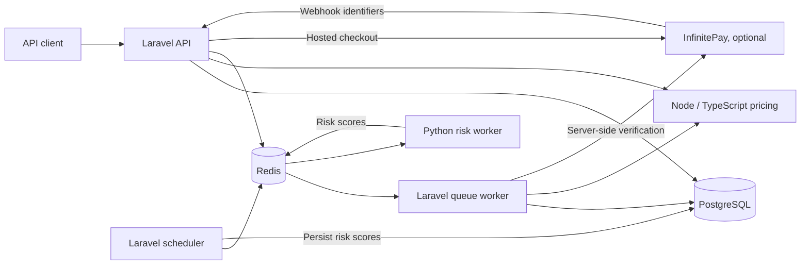

# Portfolio Billing

[](composer.json)
[](composer.json)
[](services/pricing/tsconfig.json)
[](services/risk-worker/pyproject.toml)
[](phpstan.neon)

A backend portfolio project that models the subscription billing lifecycle:
trials, activation after payment, prorated plan changes, renewals, failed-payment
recovery and cancellation. It combines a **Laravel billing API**, a
**Node/TypeScript pricing service** and a **Python risk worker**, with PostgreSQL
for financial records and Redis for queues, caching and distributed locks.

The business problem is keeping subscription access, invoice amounts and payment
state consistent when customers change plans, providers send delayed callbacks
or background jobs retry. The implementation includes explicit financial rules,
auditable changes and concurrency guards for those cases.

[Source on GitHub](https://github.com/joaobuti/portfolio) ·
[GitLab / CI](https://gitlab.com/joaobuti/portfolio) ·
[OpenAPI contract](docs/openapi.json) ·
[Delivery status](docs/STATUS.md)

## What is implemented

| Capability | Business behavior |
| --- | --- |
| Subscription lifecycle | Monthly, quarterly and yearly plans; free trials; scheduled or immediate cancellation. |
| Payment-gated activation | Without a trial, an immediate proportional invoice is issued. Access remains blocked until settlement. |
| Plan changes | A persisted preview quote preserves tax, coupon and timing. Upgrades issue a separate adjustment invoice; unpaid adjustments can revert the change. Downgrades default to the next period. |
| Renewal and recovery | Hourly renewal sweep, durable invoice attempts and scheduled retries for eligible payment failures. Billing boundaries use day 10 in America/Sao_Paulo. |
| Pricing | Regional tax and coupon calculation with timeouts, a circuit breaker, degraded fallback and automatic recalculation. |
| Payments | Deterministic fake gateway for local evaluation; optional InfinitePay Pix/card hosted checkout with server-side verification. |
| Risk processing | Python consumes failed-payment events over Redis, scores delinquency risk and returns scores to Laravel. |
| API security and operations | Sanctum bearer tokens, ability scopes, customer ownership policies, correlation IDs and staff-only Prometheus metrics. |

This is an API and background-services project. A React dashboard is planned;
there is no frontend or configured hosted demo. InfinitePay handles payments per
invoice; automatic recurring card debit, refunds, credit notes and partial
payments are outside the implemented scope. Account registration, password reset
and email verification are also excluded. See [scope and evidence](docs/STATUS.md).

## Architecture and engineering decisions



**Laravel MVCS keeps business rules in services.** Controllers validate and
delegate; Eloquent handles persistence. Money arithmetic, proration, enums and
DTOs are isolated from framework dependencies, with architecture tests enforcing
the boundary. [Architecture and trade-offs](docs/ARCHITECTURE.md).

**Concurrency is part of the financial model.** A PostgreSQL partial unique
index allows only one open subscription per customer, including one awaiting
payment. Renewal jobs re-read state under a Redis lock, while a unique invoice
index prevents duplicate non-adjustment invoices for the same period. Upgrade
adjustments are linked uniquely to their plan change.

**External systems can fail or deliver twice.** Pricing can degrade and recover;
risk messages have retry, idempotency and dead-letter handling. InfinitePay
callbacks enter a durable inbox and trigger server-side verification before
settlement. A browser redirect or unsigned webhook is not payment approval.

**Business decisions are recorded alongside the code.** The
[ADRs](docs/adr/) explain service boundaries, token scopes, messaging and payment
policies. [ADR-0011](docs/adr/0011-payment-activation-billing-day-and-adjustments.md)
records activation, billing dates and upgrade adjustments.

| Component | Technologies |
| --- | --- |
| Billing API and jobs | PHP 8.3, Laravel 13, Sanctum, PostgreSQL 17, Redis 7 |
| Pricing service | Node 22, strict TypeScript, no runtime npm dependencies |
| Risk worker | Python 3.12, Redis, strict mypy, ruff, pytest |
| Quality and delivery | Pest, PHPStan maximum level, Pint, Rector, Docker Compose, GitLab CI |

## Suggested code review path

For a focused technical evaluation, start with:

1. [Subscription service](app/Services/Subscriptions/SubscriptionService.php): lifecycle rules, transactions, locking and plan changes.
2. [Money](app/Support/Money.php) and [proration](app/Services/Subscriptions/ProrationCalculator.php): framework-independent financial arithmetic.
3. [Financial policy tests](tests/Feature/Services/Billing/FinancialPolicyTest.php): activation, quoted adjustments and recovery scenarios.
4. [Checkout tests](tests/Feature/Services/Billing/InfinitePayCheckoutTest.php): asynchronous verification and settlement behavior.
5. [Architecture tests](tests/Arch.php): dependency boundaries and conventions enforced by tests.
6. [Pricing service](services/pricing/README.md) and [risk worker](services/risk-worker/README.md): the TypeScript and Python components.

## Quality and verification evidence

The financial-policy verification recorded on **2026-11-22** reports
**384 PHP tests, 1,009 assertions and 93.9% line coverage** on PostgreSQL 17 and
Redis 7, above the 80% coverage gate. It also records passing PHPStan, Pint,
Rector, architecture checks and OpenAPI validation. These are dated local
results; consult GitLab for the current pipeline status.
[Verification details](docs/STATUS.md#financial-policy-verification-2026-11-22).

The [GitLab pipeline](.gitlab-ci.yml) defines formatting, static analysis,
PHP tests, coverage, dependency auditing and production image builds. Pricing
and risk checks run when their service files change. GitHub hosts the public
copy; no separate GitHub Actions workflow or production deployment is configured.

## Run the local demo

Requirements: Git and Docker with Compose v2. Use Linux, macOS or WSL2 on
Windows. The initial build requires internet access. PHP, Composer, Node and
Python run inside containers; GNU Make is optional for the shortcuts below.

```bash
git clone https://github.com/joaobuti/portfolio.git portfolio-billing
cd portfolio-billing
docker compose up -d --build --wait
curl --fail http://localhost:8000/up
```

Compose starts seven services: API, Laravel queue worker, scheduler, pricing,
Python risk worker, PostgreSQL and Redis. Development startup creates a local
`.env` and application key if missing, installs Composer dependencies, runs
migrations and seeds plans plus a demo customer. The default fake gateway takes
no money and requires no provider credentials. No login account is seeded.

Follow the [demo authentication steps](docs/DEVELOPMENT.md#run-it) to create a
local user, issue a bearer token and request plans. The API runs at
`http://localhost:8000/api/v1`. The [OpenAPI 3.1 contract](docs/openapi.json)
documents all **16 operations**, including subscriptions, quote confirmation,
invoices, checkout, authentication and metrics. Requests require their documented
scopes and ownership or staff permissions.

Useful checks after startup:

```bash
make test                # PHP Unit, Arch and Feature suites
make check               # Pint, PHPStan, Rector and PHP tests
make entrypoint-check    # isolated startup regression check
# Without GNU Make:
docker compose exec app php artisan test
```

Feature tests default to SQLite and an array cache; CI overrides them with
PostgreSQL and Redis. Node and Python have their own checks in the service
READMEs. For the standalone money/proration checks, `make domain-check` requires
PHP 8.3+ on the host but no Composer dependencies or database.

Use `docker compose ps` and `docker compose logs -f` to inspect startup. Stop with
`docker compose stop` to retain data. **`make down` deletes database and Redis
volumes.** Port overrides and complete setup instructions are in the
[development guide](docs/DEVELOPMENT.md).

## Further documentation

| Guide | Contents |
| --- | --- |
| [Architecture](docs/ARCHITECTURE.md) | Boundaries, invariants and design trade-offs |
| [ADRs](docs/adr/) | Technical decisions and approved financial policies |
| [Delivery status](docs/STATUS.md) | Implemented scope, exclusions and dated verification |
| [Development and publishing](docs/DEVELOPMENT.md) | Configuration, scheduled work, container startup and dual GitLab/GitHub pushes |
| [Operations](docs/OPERATIONS.md) | Local HTTPS webhooks, checkout recovery and Prometheus metrics |
| [OpenAPI](docs/openapi.json) | Request/response schemas and security requirements |
| [AI remediation design](docs/AI_REMEDIATION.md) | Approved architecture for incident triage, tested fixes and reviewed GitLab Merge Requests; implementation pending |
| [Dashboard design](docs/DASHBOARD.md) | Customer and read-only operations areas, reviewed wireframes, accepted stack and planned API/session changes; implementation pending |

## Planned work

- **Customer and operations dashboard (current priority):** React/TypeScript,
  Portuguese/English, customer self-service and read-only internal inquiry.
  The owner selected the scope, navigation, financial review flows and technical
  stack; low-fidelity wireframes were reviewed. The local/public demo design
  uses isolated synthetic data and simulated payments. Frontend, session/API
  adaptations and deployment remain pending.
  [Specification](docs/DASHBOARD.md) ·
  [ADR-0013](docs/adr/0013-customer-and-operations-dashboard.md).
- **AI-assisted incident remediation:** an approved design for detecting errors,
  reproducing code defects in isolation and opening tested GitLab Merge Requests.
  Human review controls merging and deployment; approved changes then synchronize
  to GitHub. The first milestone is a controlled demonstration. No remediation
  agent or continuous monitor is implemented yet.
  [Architecture, safeguards and acceptance criteria](docs/AI_REMEDIATION.md) ·
  [ADR-0012](docs/adr/0012-ai-assisted-incident-remediation.md).

## License

MIT, as declared in [composer.json](composer.json).
