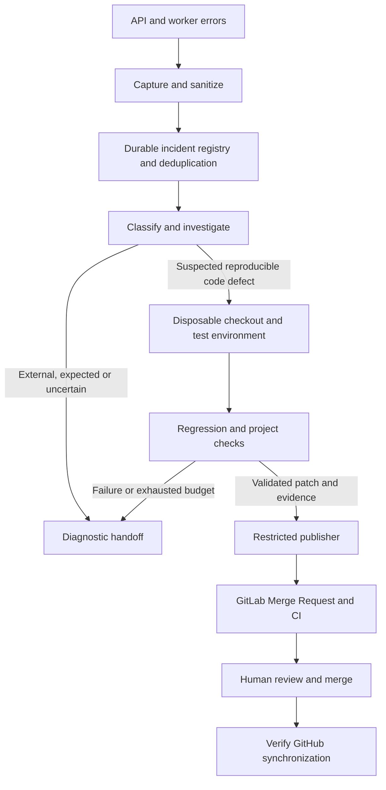

# AI-assisted incident remediation

Status: architecture approved on **2026-11-23**; implementation and activation
pending. This document specifies planned behavior. No collector, coding agent,
publisher or continuous monitor is delivered by this documentation change.
The governing decision is [ADR-0012](adr/0012-ai-assisted-incident-remediation.md).

## Objective and first delivery

Turn a reproducible application code defect into a tested correction and a
reviewable GitLab Merge Request without requiring a person to write the patch.
Human reviewers retain control over policy changes, merges and deployments.

The first delivery is a controlled, synthetic demonstration spanning detection
through MR publication. It must be repeatable without production data, provider
accounts or real payments. Continuous monitoring is a later activation step;
PHP, Node and Python are intended coverage, with each collector verified before
claiming support for that component.

## Responsibilities and trust boundaries

The diagram describes responsibilities, not a mandated deployment topology.
The application captures incidents without waiting for an LLM or code runner.
Failure of the remediation service must not prevent billing requests, logging
or existing jobs from completing. Agent-generated commits and runner failures
must not automatically trigger unbounded new remediation attempts.

## Incident inputs and data lifecycle

Accept errors from trusted collectors for Laravel requests/queue jobs and the
Node/Python services. A public request body must not directly trigger a coding
job. Collector authentication and source attribution are required.

An incident envelope should contain an internal identifier, service, release
commit, occurrence times/count, environment category, normalized exception type
and stack frames, correlation identifier and a small allowlisted diagnostic
context. Do not collect request bodies, authorization headers, cookies, tokens,
payment credentials, connection strings or customer/payment records by default.
Sanitize before persistence and model submission; sanitize artifacts again before
publication. Existing application-log retention does not define this registry's
retention policy automatically.

Deduplicate by service, relevant code revision and normalized error location/type,
excluding variable customer inputs. Track new occurrences against the existing
incident/MR; use durable uniqueness and execution locks so concurrent deliveries
do not start duplicate runs. Retain a mapping from source release to remediation
base and the exact tested commit. If the reported source revision is unavailable
or the issue cannot be reproduced on the intended target, hand off explicitly.

Keep incident context private to the remediation system. Only sanitized,
necessary summaries and synthetic fixtures may enter Git history, CI artifacts
or MR descriptions. Define retention and deletion separately for incidents,
model interactions, runner artifacts and audit metadata before activation.

## Classification and workflow

| Classification | Response |
| --- | --- |
| Expected business rejection | Record/group if useful; do not alter the rule to suppress the event. |
| Infrastructure, provider or configuration failure | Produce a diagnostic handoff; no speculative code fix. |
| Suspected application code defect | Attempt isolated reproduction and a minimal correction within policy. |
| Uncertain, sensitive or unreproducible incident | Request human analysis with evidence and uncertainty stated. |

Use the following logical lifecycle; storage names can be chosen during
implementation: received → sanitized/grouped → triaged → reproducing → fixing
→ validating → MR opened → human review → merged/rejected → synchronization
verified. Separate outcomes cover duplicate incidents, failed validation,
unreproducible defects, policy blocks, exhausted budgets and publication errors.
Do not report an MR as opened without its remote identifier, or remediation as
deployed because a branch was merged.

1. Capture, sanitize, persist and group the incident before scheduling analysis.
2. Collect bounded source context at a known revision and classify the cause.
3. Reproduce a code defect using synthetic data and a regression test that fails
   on the unmodified target for the relevant reason.
4. Create a branch such as `codex/incident-<id>` and apply the smallest supported
   fix in a disposable checkout. Do not remove assertions, weaken quality gates
   or reinterpret financial policies merely to make checks pass.
5. Demonstrate that the regression passes with the patch, then run the required
   affected-component checks and CI. Preserve baseline failures distinctly from
   failures introduced by the patch.
6. Publish a sanitized GitLab MR with the evidence below. A publication retry
   must reuse the existing incident/branch/MR identity, not create duplicates.
7. Await human review. Record rejected hypotheses and reviewer feedback; further
   iterations remain subject to the same attempt, time and cost budgets.
8. After an approved merge, synchronize its resulting commit with GitHub and
   verify both `main` refs. A failed sync remains visible and retryable without
   re-running the coding job or repeating the merge.

## Autonomy and execution policy

| Action | Boundary |
| --- | --- |
| Read sanitized context and repository source | Allowed within the incident's scope. |
| Generate tests, modify code and run checks | Allowed only in a disposable environment with synthetic data. |
| Create a branch and publish an MR | Allowed through a separate restricted publisher after policy checks. |
| Financial rules, authentication or migrations | Require explicit specialist human review; no autonomous policy decision. |
| Merge, deploy, rewrite protected history or change production data | Not permitted to the remediation agent. |

Isolate execution from application infrastructure and production networks. Never
mount the host Docker socket, production secrets or the publisher's credentials
into the coding/test environment. Tests run without live payment endpoints.
Use explicit resource limits, timeouts and controlled network access. Treat
logs, stack traces, repository text and model output as untrusted input; none
may grant permissions or become interpolated shell commands.

Numerical limits must be configured before activation: concurrent runs, attempts
per incident, maximum duration, model usage/cost, artifact size and repeated-error
cooldowns. Enforce limits in the orchestrator, not solely in the prompt. A kill
switch must stop new runs and allow cancellation of active ones. Failure to load
policy, sanitize context or apply a required limit must stop the affected run.

## Validation and MR evidence

For PHP changes, use the existing formatting, PHPStan maximum level, Rector and
Unit/Arch/Feature gates, with the relevant financial/integration checks against
PostgreSQL and Redis. Run pricing TypeScript/tests and risk ruff/mypy/pytest when
those components are affected. Run cross-service regressions when a shared
contract changes; validate OpenAPI when applicable. Changed container startup
requires its regression checks. Do not claim unrelated or unexecuted checks.

Before calling a correction validated, record the tested source/patch commit,
commands, outcomes, baseline comparison and relevant artifacts. GitLab CI and
protected-branch requirements remain authoritative. If publication occurs before
remote CI completes, mark the MR as awaiting CI; it is not ready to merge until
required checks pass. Failed or missing required checks cannot be summarized as
success. A blocked run produces a diagnostic handoff; a draft MR, if appropriate,
must clearly identify unresolved validation and cannot be presented as a fix.

Every MR should contain:

- Sanitized incident summary, affected component and internal reference.
- Reproduced behavior, root-cause hypothesis and reproduction conditions.
- Change rationale and regression test failing before/passing after the fix.
- Exact validation evidence, remaining uncertainty and sensitive areas touched.
- Scope/rollback considerations for the proposed code change.

## GitLab and GitHub publication

GitLab owns review, CI and merge. GitHub remains the public portfolio mirror;
opening equivalent requests on both services would split review history.
Never copy raw incident artifacts into the public repository.

The existing [dual-push configuration](DEVELOPMENT.md#publishing-to-gitlab-and-github)
applies only to pushes made from a configured clone. It does not replicate a
GitLab server-side merge. The implementation must add an explicit post-merge
synchronization mechanism or verified publication worker. Its exact hosting and
credential mechanism remain an implementation choice. Use normal fast-forward
publication, verify the resulting refs and surface divergence for human
resolution; never force-push over independent GitHub work.

## Acceptance criteria for the controlled demonstration

| ID | Required evidence |
| --- | --- |
| A1 | A synthetic code defect is captured with service/revision attribution; repeated events create one incident and at most one active run/MR. |
| A2 | Synthetic secret/customer markers are removed before model access, persistence and publication; forged collector events are rejected. |
| A3 | The regression fails on the unmodified target and passes with the proposed patch; applicable component checks are recorded. |
| A4 | A GitLab MR is created automatically with the exact patch and sanitized evidence; retrying publication does not duplicate it. |
| A5 | Infrastructure failure, expected business rejection, uncertain diagnosis and unreproducible defects lead to explicit handoffs without fabricated fixes. |
| A6 | The agent cannot merge, deploy, reach production/payment systems or obtain the publisher's credentials; sensitive changes require designated human review. |
| A7 | Attempt/time/cost limits, deduplication under concurrency, cancellation and the kill switch are exercised; the agent cannot create a retry loop. |
| A8 | After a human-approved test merge, GitLab and GitHub refs match; synchronization failure is visible and a retry preserves unrelated work. |
| A9 | Logs/MR/audit records distinguish detected, proposed, validated, merged and synchronized outcomes; no deployment is claimed. |

Evaluate reproducibility, correctness of proposed fixes, false classifications,
time/cost per incident and human review feedback before continuous operation.
Do not claim autonomous repair accuracy from a single demonstration.

## Pending implementation and activation configuration

- Coding engine/provider, model/version and authenticated API configuration.
- Collector/transport choice, error envelope schema and incident registry storage.
- Runner hosting, isolation, network policy and dependency acquisition strategy.
- Numerical budgets, concurrency, deduplication/cooldown and retention periods.
- GitLab publication identity, required reviewers/branch rules and GitHub sync identity.
- Destination for diagnostic handoffs and operational ownership of the kill switch.
- Runtime deployment and the explicit decision to enable continuous monitoring.

These are deliberately unresolved configuration choices. The owner has approved
the architecture and limits in ADR-0012; documenting it does not install agents,
provision credentials, incur model usage or authorize a production rollout.
