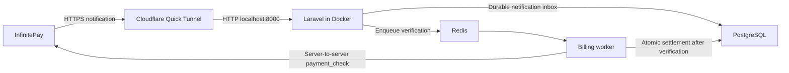

# Development and publishing

Setup and maintainer workflows for Portfolio Billing. See the [project overview](../README.md).

## Run it

Requirements: Git, Docker Engine or Docker Desktop with Compose v2, and GNU
Make in a Unix-compatible shell (Linux, macOS or WSL2 on Windows). Host PHP,
Composer, Node and Python are not needed for the Docker quick start. The first
boot downloads dependencies and builds images, so it requires internet access.

The source is available on [GitHub](https://github.com/joaobuti/portfolio) and
[GitLab](https://gitlab.com/joaobuti/portfolio). GitLab remains the primary remote
for pulls and CI.

```bash
git clone https://github.com/joaobuti/portfolio.git portfolio-billing
cd portfolio-billing
make up
docker compose up -d --wait
curl --fail http://localhost:8000/up
```

That starts seven services: the API, Laravel queue worker, scheduler, pricing
service, Python risk worker, Postgres and Redis. The API runs migrations and
seeds a plan catalogue and demo customer. It does not create a login account.
Development startup copies `.env.example` to `.env` if missing, installs Composer
dependencies and generates a local application key. The default gateway is
`fake`, so the demo needs no payment-provider account.

The API is exposed at `http://localhost:8000/api/v1`; pricing health is available
at `http://localhost:3001/health`. Default host ports are 8000 (API), 3001
(pricing), 5432 (Postgres) and 6379 (Redis). Override `APP_PORT`, `PRICING_PORT`,
`DB_PORT_HOST` or `REDIS_PORT_HOST` in `.env` if a port is occupied; adjust the
URLs in these examples when changing the API port. Use `docker compose ps` and
`make logs` to inspect startup failures.

Use `docker compose stop` to stop the stack and retain its data. `make down`
removes the database and Redis volumes; `make fresh` rebuilds the database.

For a local demo, create a user in Tinker:

```bash
make tinker
```

```php
App\Models\User::factory()->belongingTo(App\Models\Customer::where('email', 'demo@example.test')->firstOrFail())->create(['email' => 'demo-user@example.test']);
```

The development factory uses the password `password`. Obtain a token:

```bash
curl -X POST http://localhost:8000/api/v1/auth/tokens \
  -H 'Accept: application/json' \
  -H 'Content-Type: application/json' \
  -d '{"email":"demo-user@example.test","password":"password","token_name":"local-demo","abilities":["plans:read"]}'
```

Copy `data.token` from the response into `BILLING_TOKEN`, then request plans:

```bash
export BILLING_TOKEN='<data.token>'
curl http://localhost:8000/api/v1/plans \
  -H 'Accept: application/json' \
  -H "Authorization: Bearer $BILLING_TOKEN"
```

```bash
make test          # the PHP suite (Unit, Arch and Feature)
make domain-check  # the pricing logic, with no Composer and no database
make entrypoint-check # startup and injected-key regression, in an isolated fixture
make check         # PHP style, static analysis, Rector and tests
```

The Node and Python checks run separately; see the
[pricing](../services/pricing/README.md) and
[risk worker](../services/risk-worker/README.md) instructions. CI also runs
coverage, dependency auditing and image builds; `make check` does not run those.

`make domain-check` is worth thirty seconds of your time: it runs the money and
proration logic with nothing but `php`, no vendor directory required. That it
*can* run that way is the architectural claim this project is making.

## Publishing to GitLab and GitHub

Git remote configuration is local to each clone. After cloning from either host,
run this once to keep GitLab as the primary remote and make `git push` (or
`git push origin main`) send to both hosts:

```bash
git remote set-url origin git@gitlab.com:joaobuti/portfolio.git
git remote add github https://github.com/joaobuti/portfolio.git
git config --local --replace-all remote.origin.pushurl git@gitlab.com:joaobuti/portfolio.git
git config --local --add remote.origin.pushurl https://github.com/joaobuti/portfolio.git
git remote -v
```

These publishing commands are for maintainers with write access and assume a
fresh clone without a `github` remote. Both hosts need authentication:
SSH for GitLab and an HTTPS credential with write access for
GitHub. Pulls still use GitLab; the `github` remote also allows
fetching or retrying a push to GitHub directly.

GitHub can also use `git@github.com:joaobuti/portfolio.git` in both URLs if
the configured SSH key has write access to this repository.

```bash
git push                  # push the current tracked branch to both hosts
git push origin --tags    # publish tags to both hosts
```

The two pushes are sequential and are not a single transaction. If one fails,
resolve its error and repeat the push; Git skips refs already up to date.
Changes pushed from another clone or merged in GitLab need a push from a clone
with this configuration to reach GitHub. This setup does not mirror server-side
changes automatically.

## Scheduled work

Keep both the Laravel worker and scheduler running. The schedule in
[`routes/console.php`](../routes/console.php) runs:

| Frequency | Work |
| --- | --- |
| Hourly (UTC) | Renew due subscriptions |
| Every minute | Collect due invoices, verify pending checkouts, retry degraded pricing and expire unpaid adjustments |
| Every five minutes | Consume risk scores returned by Python |

Billing boundaries use day 10 in `America/Sao_Paulo`, independently of the
renewal sweep's UTC schedule. Laravel workers consume `billing`, `observability`
and `default`; the Python worker exchanges risk messages through Redis lists.

## Container startup

The development API completes migrations and demo seeding before its health
check allows the Laravel worker and scheduler to start. Repeated local seeding
creates missing demo records and preserves existing catalogue edits.

The production image excludes local `.env`, host `vendor`, Git metadata and
tests. Supply `APP_KEY` and database/Redis settings at runtime. Startup caches
that resolved configuration and runs migrations without demo seeding. It never
generates a production key. Existing customer/account provisioning remains the
responsibility described in ADR-0006.

## InfinitePay checkout

The billing API remains Laravel; pricing is Node/TypeScript and risk processing
is Python. The InfinitePay adapter runs natively in Laravel, using the same
merchant account as an existing integration if desired. See
[ADR-0009](adr/0009-infinitepay-hosted-checkout.md) and the complete
[OpenAPI 3.1 contract](openapi.json).

Configure these settings through the server environment or secret manager:

```dotenv
BILLING_GATEWAY=infinitepay
INFINITEPAY_HANDLE=your-infinite-tag-without-dollar-sign
INFINITEPAY_API_KEY=your-server-side-api-key
INFINITEPAY_WEBHOOK_URL=https://your-domain/api/v1/webhooks/infinitepay
INFINITEPAY_REDIRECT_URL=https://your-frontend/payment-return
```

`INFINITEPAY_REDIRECT_URL` is optional. The webhook must be a public HTTPS URL
for this project. Rebuild Laravel's configuration cache after changing settings
and restart queue workers. Run the application migrations before activating
the adapter; no live activation is bundled with this change. Keep the existing
queue worker and scheduler running: payment verification uses the configured
billing queue, and `checkouts:verify` recovers pending notifications every minute.

The API key is required for single-payment links and their expiry even if an
older integration works with only an InfiniteTag. In JBoot, the account handle
comes from the payments database's `provider_connections.public_identifier`,
not its environment template. A stored `secret_ref` is a reference to retrieve
securely, not an API key to paste into source or chat. This implementation does
not migrate or dump JBoot's database.

| Operation | Token ability | Purpose |
| --- | --- | --- |
| `GET /api/v1/subscriptions/{uuid}/invoices` | `invoices:read` | Owned invoices, 20 per page |
| `GET /api/v1/invoices/{uuid}` | `invoices:read` | Invoice amounts and current checkout state |
| `POST /api/v1/invoices/{uuid}/checkout` | `invoices:write` | Create or retrieve the one stored checkout intent |
| `POST /api/v1/invoices/{uuid}/payment-check` | `invoices:write` | Submit redirect identifiers for asynchronous verification |
| `POST /api/v1/webhooks/infinitepay` | Public | Persist unsigned identifiers for server verification |

Customer ownership is checked in addition to token abilities. Existing tokens
need reissuing to gain the invoice abilities. Checkout and payment-check respond
with 202; inspect invoice state afterwards rather than treating the response
as payment approval. Submit `transaction_nsu` and either `slug` or
`invoice_slug`; the public webhook also requires `order_nsu`. The authenticated
endpoint takes the order from the invoice and can retry an exhausted signal.

Link creation requires a due, open, non-degraded BRL invoice of at least R$1.
A zero invoice still settles locally. Links expire after seven days by default.
Unknown, failed and expired intents are kept for reconciliation and are not
replaced automatically. Verified late payments can still settle the invoice.
This flow supports Pix/card payments per invoice; it does not debit saved cards
on a recurring schedule. Refunds remain excluded. The approved financial policies are described in
[ADR-0011](adr/0011-payment-activation-billing-day-and-adjustments.md).

Tests use Laravel HTTP fakes; they do not create real links or payments.
The shipped default remains `BILLING_GATEWAY=fake` until securely configured.

### Local webhooks through an HTTPS tunnel

The full stack can run locally in Docker while InfinitePay delivers payment
notifications through a temporary Cloudflare Quick Tunnel. Docker publishes
the Laravel API on **host port 8000 → container port 8000** by default;
`APP_PORT` changes the host port. Run `cloudflared` on the same host:

```bash
docker compose up -d --build
# Wait for the app to become healthy, then check the local origin:
curl --fail http://localhost:8000/up
# Keep this running in a separate terminal:
cloudflared tunnel --url http://localhost:8000
```

Use the HTTPS hostname printed by `cloudflared` in your local `.env`:

```dotenv
INFINITEPAY_WEBHOOK_URL=https://your-tunnel.trycloudflare.com/api/v1/webhooks/infinitepay
```

Replace the example hostname with the generated one. `localhost` is the
tunnel's origin; the webhook uses the public HTTPS address because InfinitePay
sends the notification from its servers. `redirect_url` is a separate browser
return flow. This follows the same local-tunnel workflow used by JBoot, with
this project's own port and webhook route.



The public address changes when a new Quick Tunnel is created. Existing
checkout links retain their original webhook URL, so keep the tunnel running
while testing those links. A callback only queues verification; settlement
requires a successful server-to-server payment check. Automated tests use HTTP
fakes. InfinitePay has no sandbox, so real checkout experiments require a
deliberate live-payment setup.

The [local webhook runbook](OPERATIONS.md#local-infinitepay-webhooks-with-cloudflare-tunnel)
covers prerequisites, credentials, configuration reload, a non-financial route
probe and handling a changed tunnel address. This documents a development
workflow; it does not imply that a public tunnel or production deployment is
currently running.

## Monitoring

`GET /api/v1/metrics` exposes read-only operational gauges for staff tokens
with `metrics:read`. The global snapshot is cached for 15 seconds and contains
only bounded status labels. Customers cannot access it, including with a
manually granted scope. See the [operations guide](OPERATIONS.md) for
metric definitions, credential rotation and a Prometheus scrape example.
No external monitoring service or alert delivery is configured by this change.

## Payment and billing rules

Without a free trial, the first invoice is due immediately and proportional to
whole days until the interval boundary on day 10 in America/Sao_Paulo. Access
stays blocked as `pending_payment` until initial settlement. Subsequent payment
boundaries use day 10; existing monthly/quarterly/yearly cadence is retained.
Free trials retain their existing access window and wait for payment afterwards.

Plan confirmation now requires the `quote_id` from the preview endpoint. Send
that identifier in `PUT /api/v1/subscriptions/{uuid}/plan` to preserve quoted
amounts, taxes, coupon and immediate/scheduled mode. Upgrades create a separate
adjustment invoice and revert only after retries are exhausted or the payment
deadline expires. The invoice response exposes `kind` and `payment_deadline_at`.
Only one unresolved adjustment is allowed at a time.

The scheduler automatically retries degraded pricing with current rules and
persisted backoff. Keep the billing worker and scheduler running: collection,
`invoices:reprice-degraded` and `invoices:expire-adjustments` sweep every minute.
Apply migrations before updating workers. `BILLING_DUE_IN_DAYS` is superseded by
the billed period boundary. See ADR-0011 for zero-balance and late-payment rules.
